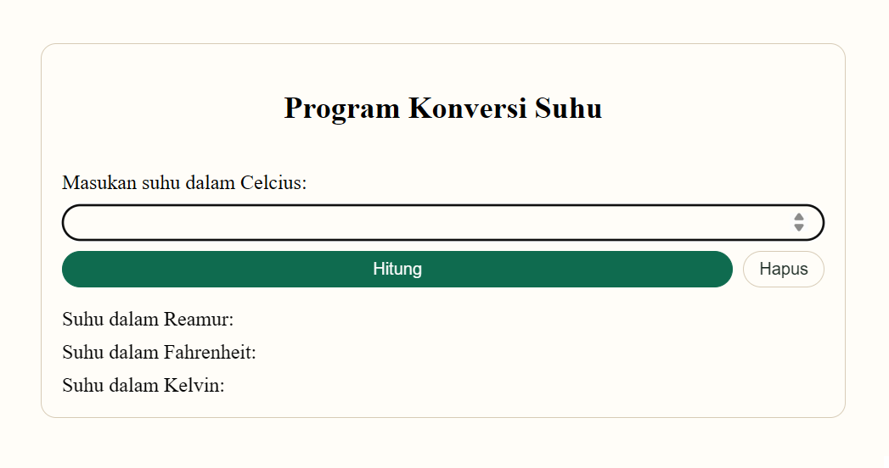

# DOM 1

## Membuat Program Konversi Suhu

### Screenshoot


### Kode HTML
```html
<!DOCTYPE html>
<html lang="en">
<head>
    <meta charset="UTF-8">
    <meta name="viewport" content="width=device-width, initial-scale=1.0">
    <title>DOM 1</title>
    <link rel="stylesheet" href="style.css">
</head>
<body>
    <div class="main">
        <div class="card">
            <h2 class="heading">Program Konversi Suhu</h2>
            <div class="input">
                <label for="suhuCelcius">Masukan suhu dalam Celcius:</label>
                <input id="inputCelcius" type="number" autofocus>
                <div class="buttons">
                    <button id="hitung">Hitung</button>
                    <button id="hapus">Hapus</button>
                </div>
            </div>
            <div class="output">
                <div>
                    Suhu dalam Reamur:&nbsp;<span id="reamur"></span>
                </div>
                <div>
                    Suhu dalam Fahrenheit:&nbsp;<span id="fahrenheit"></span>
                </div>
                <div>
                    Suhu dalam Kelvin:&nbsp;<span id="kelvin"></span>
                </div>
            </div>
        </div>
    </div>

    <script src="index.js"></script>
</body>
</html>
```

### Kode JavaScript
```javascript
const hitung = document.getElementById("hitung");
const hapus = document.getElementById("hapus");

hitung.addEventListener("click", (event) => {
    const celcius = parseInt(document.getElementById("inputCelcius").value);
    const reamur = 4 / 5 * celcius;
    const fahrenheit = (9 / 5 * celcius) + 32;
    const kelvin = celcius + 273;

    document.getElementById("reamur").textContent = reamur;
    document.getElementById("fahrenheit").textContent = fahrenheit;
    document.getElementById("kelvin").textContent = kelvin;
});

hapus.addEventListener("click", (event) => {
    document.getElementById("inputCelcius").value = "";
    document.getElementById("reamur").textContent = "";
    document.getElementById("fahrenheit").textContent = "";
    document.getElementById("kelvin").textContent = "";
});
```

### Style CSS
```css
:root {
    --bg-color-white: rgba(255, 253, 248, 1);
    --bg-color-green: rgba(15, 107, 79, 1);

    --font-color-black: rgba(19, 35, 27, 1);
    --font-color-white: rgba(255, 255, 255, 1);

    --border-color-gray: rgba(215, 203, 182, 1);
    --border-color-green: rgba(15, 107, 79, 1);
}

body {
    background-color: var(--bg-color-white);
}

.main {
    width: 50%;
    justify-self: center;
}

.card {
    display: flex;
    flex-direction: column;
    padding: 16px;
    background-color: var(--bg-color-white);
    border: 1px solid var(--border-color-gray);
    border-radius: 12px;
    gap: 16px;
}

.heading {
    text-align: center;
}

.input {
    display: flex;
    flex-direction: column;
    gap: 8px;
}

.output {
    display: flex;
    flex-direction: column;
    gap: 8px;
}

.buttons {
    display: flex;
    flex-direction: row;
    gap: 8px;
}

#inputCelcius {
    background-color: var(--bg-color-white);
    border: 1px solid var(--border-color-gray);
    color: var(--font-color-black);
    border-radius: 999px;
    padding: 6px 12px;
}

#hitung {
    display: flex;
    width: 100%;
    background-color: var(--bg-color-green);
    border: 1px solid var(--border-color-green);
    color: var(--font-color-white);
    border-radius: 999px;
    padding: 6px 12px;
    justify-content: center;
}

#hapus {
    display: flex;
    width: fit-content;
    background-color: var(--bg-color-white);
    border: 1px solid var(--border-color-gray);
    color: var(--font-color-black);
    border-radius: 999px;
    margin-left: auto;
    padding: 6px 12px;
    justify-content: center;
}
```